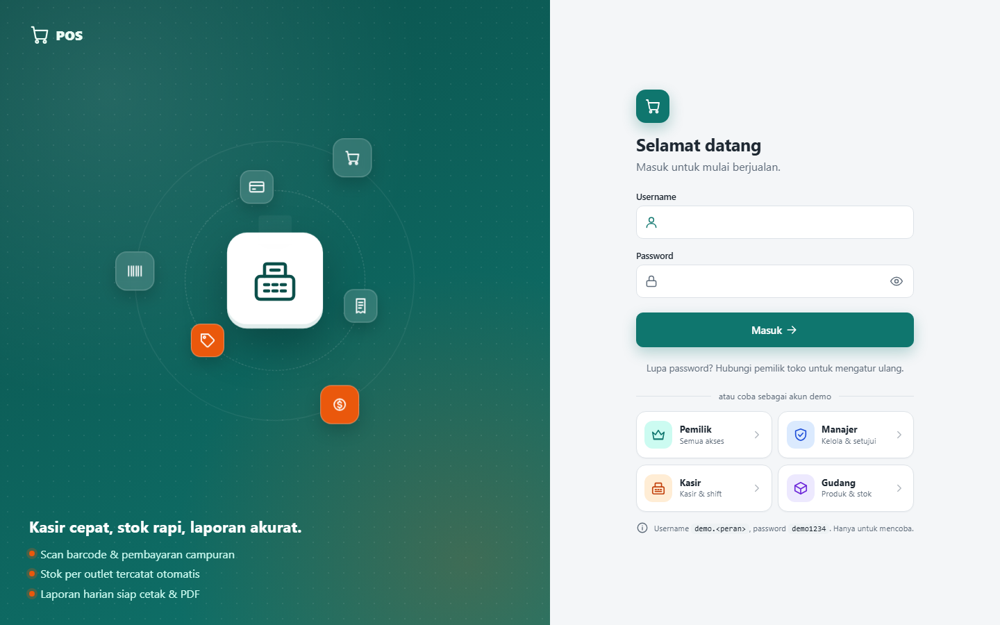
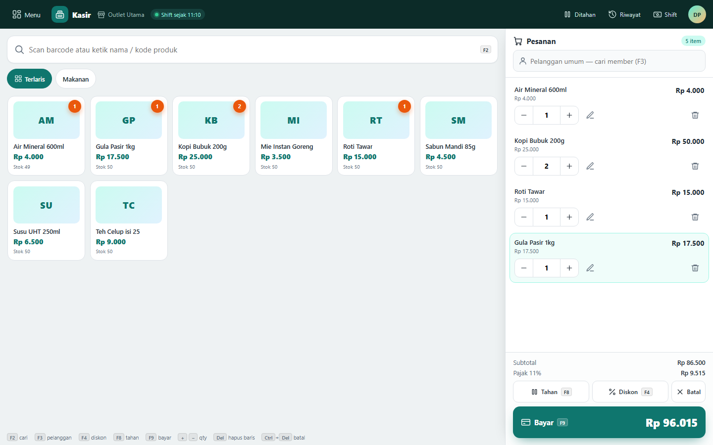
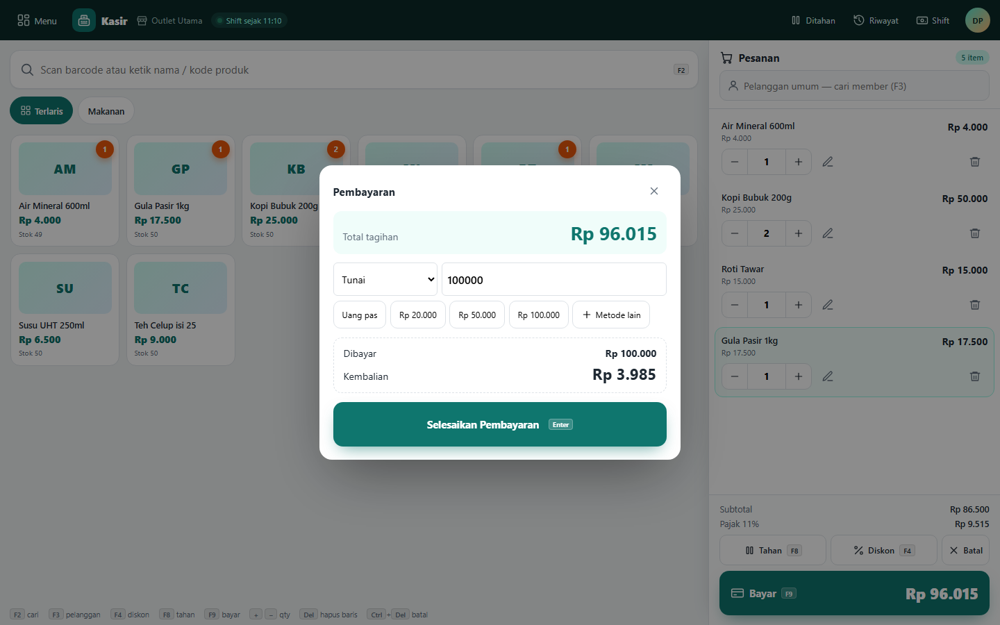
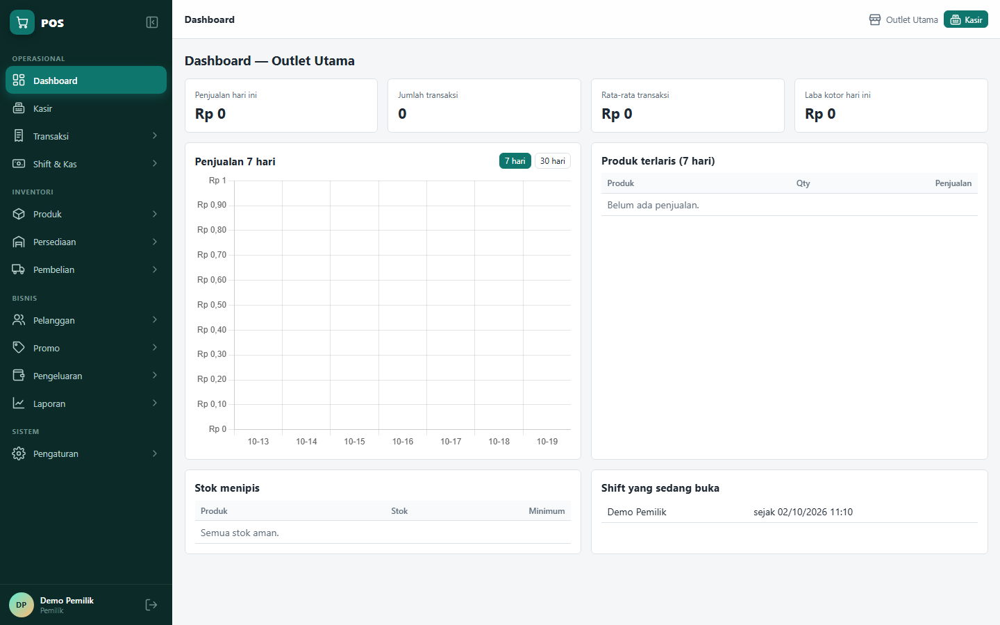
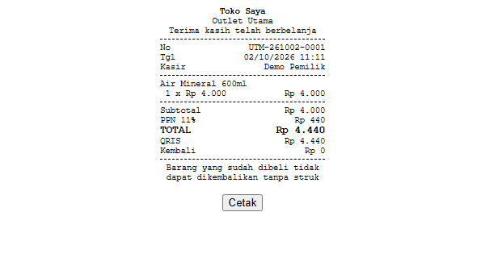
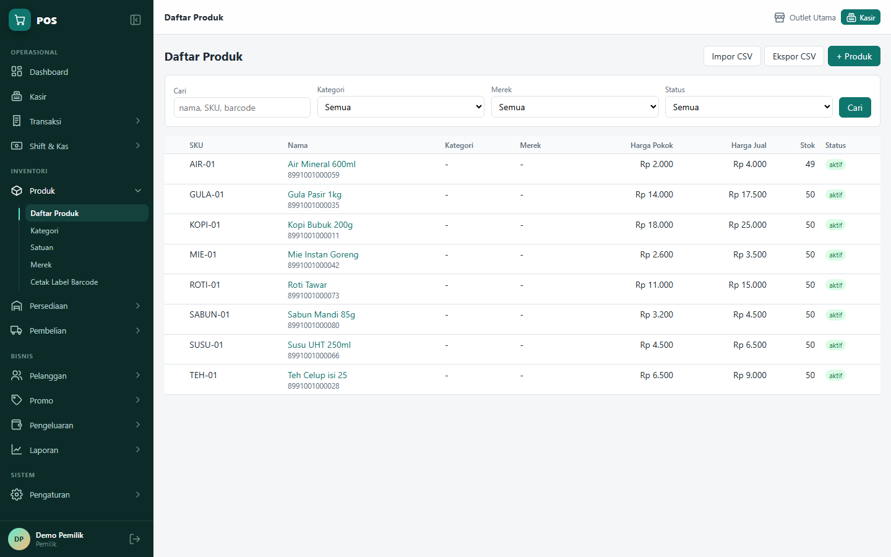
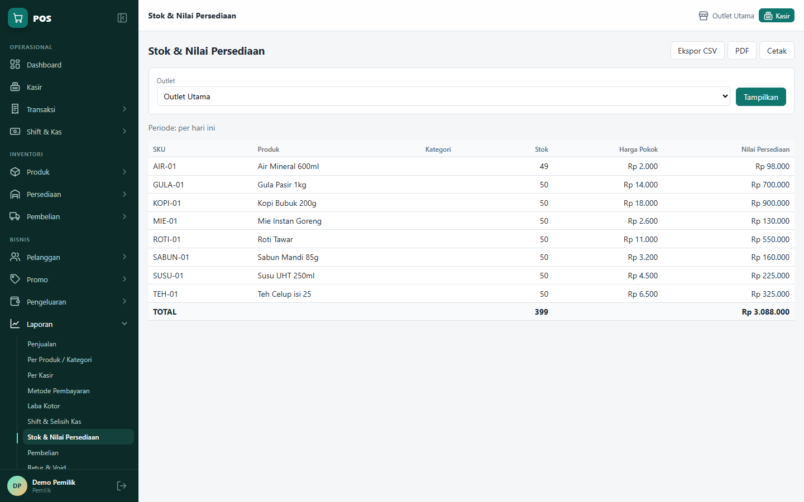
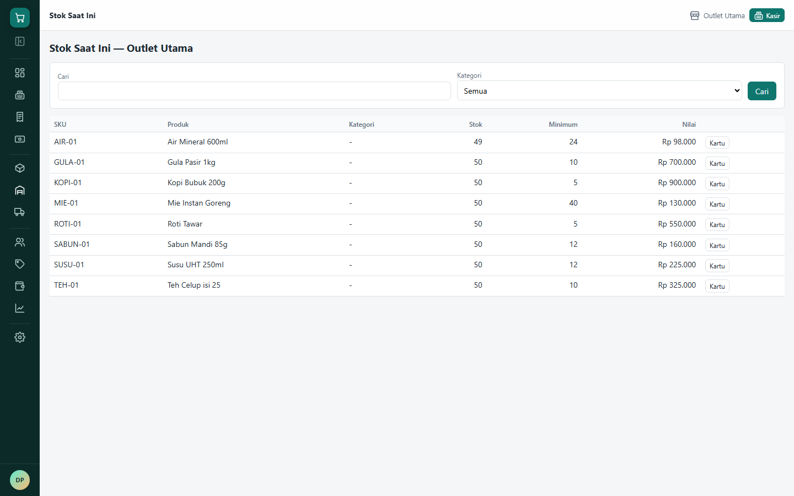

# POS — Aplikasi Kasir Retail

Aplikasi **Point of Sale** berbasis web untuk toko retail: kasir cepat dengan scan barcode, pembayaran campuran, shift & kas, stok per outlet, pembelian, member & poin, promo, sampai laporan CSV/PDF.

Dibuat ringan dan sederhana: **Node.js + Express + EJS + HTMX/Alpine.js + PostgreSQL**, tanpa tahap build, tanpa ORM, dan tanpa library yang butuh kompilasi native. Seluruh antarmuka memakai Bahasa Indonesia dan mata uang Rupiah.



## Tampilan

### Kasir
Cari atau scan barcode, ketuk produk dari grid kategori (terlaris dulu), atur jumlah dengan tombol −/+, beri diskon dan catatan per barang, lalu bayar. Semua aksi utama punya pintasan keyboard.



### Pembayaran
Boleh lebih dari satu metode dalam satu transaksi (tunai, transfer, QRIS, kartu, e-wallet, piutang). Kembalian dihitung otomatis, ada tombol uang pas dan pecahan cepat.



### Dashboard
Penjualan hari ini, jumlah dan rata-rata transaksi, laba kotor (hanya untuk peran yang berhak), grafik 7/30 hari, produk terlaris, stok menipis, dan shift yang sedang buka.



### Struk, produk, laporan

| Struk 58 / 80 mm | Daftar produk |
|---|---|
|  |  |



Sidebar bisa diciutkan menjadi ikon saja (pilihan diingat di browser):



## Fitur

| Area | Isi |
|---|---|
| **Kasir** | scan barcode, pencarian nama/kode, grid produk per kategori, diskon per item dan per transaksi, voucher, harga grosir otomatis, pilih member dan pakai poin, tahan dan lanjutkan transaksi, cetak ulang dan kirim struk lewat email |
| **Transaksi** | riwayat dengan filter, detail, retur sebagian atau seluruhnya, void dengan alasan dan persetujuan supervisor |
| **Shift & Kas** | buka shift dengan modal awal, kas masuk/keluar, tutup shift dengan hitung uang fisik, selisih kas, laporan shift cetak |
| **Produk** | kode/SKU, barcode, kategori, merek, satuan, foto, varian, satuan bertingkat (pcs, lusin, dus), impor/ekspor CSV, cetak label barcode (Code 128) |
| **Persediaan** | stok per outlet, kartu stok, penyesuaian, stok opname dengan persetujuan, mutasi antar outlet, daftar stok minimum |
| **Pembelian** | pemasok, pesanan pembelian (PO), penerimaan barang sebagian, harga pokok rata-rata otomatis, retur pembelian, hutang pemasok |
| **Pelanggan** | data pelanggan, riwayat belanja, member dan poin, piutang dan pelunasannya |
| **Promo** | diskon produk/kategori dengan masa berlaku, voucher berkuota, harga grosir bertingkat |
| **Pengeluaran** | biaya operasional per kategori |
| **Laporan** | 11 laporan (penjualan, per produk/kategori, per kasir, metode bayar, laba kotor, shift, stok, pembelian, retur & void, pajak, pengeluaran), ekspor CSV dan PDF |
| **Pengaturan** | profil toko dan logo, outlet, pengguna dan peran, metode pembayaran, pajak dan pembulatan, struk, format nomor dokumen, cadangan data, log audit |

Peran bawaan: **Pemilik** (semua akses), **Manajer/Supervisor** (semua kecuali pengaturan sistem, bisa menyetujui void, retur, opname), **Kasir** (kasir, shift dan riwayat sendiri, tanpa harga beli dan laba), **Gudang** (produk, persediaan, pembelian). Menu yang tampil mengikuti peran.

## Dirancang agar angka uang dan stok tidak meleset

- **Server yang menghitung.** Subtotal, diskon, pajak, total, dan kembalian dihitung ulang di server dari data produk. Angka kiriman browser tidak dipercaya.
- **Penjualan atomik.** Penjualan, item, pembayaran, mutasi stok, voucher, poin, dan piutang disimpan dalam satu transaksi database; gagal di tengah berarti `ROLLBACK` penuh.
- **Tidak ada transaksi ganda.** Form bayar membawa kunci UUID, jadi klik ganda atau kirim ulang hanya menyimpan satu transaksi.
- **Salinan harga.** Setiap item menyimpan nama, harga jual, harga pokok, diskon, dan pajak saat transaksi; mengubah harga produk tidak mengubah transaksi lama.
- **Tanpa float.** Uang `NUMERIC(15,2)`, kuantitas `NUMERIC(15,4)`. Di JavaScript, uang dihitung sebagai BigInt sen (`lib/money.js`).
- **Nomor struk berurutan** per outlet per hari, dibuat di dalam transaksi penjualan sehingga tidak ada nomor bolong.
- **Soft delete** di semua tabel dan **log audit** untuk aksi penting.

## Teknologi

| Lapisan | Pilihan |
|---|---|
| Runtime | Node.js 20 atau lebih baru |
| Server | Express 4 |
| Tampilan | EJS di server, HTMX + Alpine.js (file statis), CSS murni |
| Database | PostgreSQL, akses lewat `pg` dengan SQL murni di folder `services/` |
| Auth | JWT di signed cookie, password `bcryptjs` |
| Job terjadwal | `node-cron` di proses worker terpisah |
| PDF | `pdfmake` |
| Grafik | Chart.js |

Total ukuran sekitar 47 MB termasuk `node_modules`.

## Menjalankan

Butuh Node.js 20+ dan PostgreSQL. Contoh perintah untuk PowerShell:

1. Salin `.env.example` ke `.env`, lalu isi `DATABASE_URL`:

   ```powershell
   Copy-Item .env.example .env
   notepad .env
   ```

   `JWT_SECRET` dan `COOKIE_SECRET` wajib diisi string acak yang panjang. Isi `SMTP_*` bila ingin mengirim struk dan peringatan stok lewat email.

2. Pasang dependency dan jalankan migrasi (database dibuat otomatis bila belum ada):

   ```powershell
   npm install
   npm run migrate
   ```

3. Buat akun pemilik, atau isi akun dan data demo:

   ```powershell
   npm run buat-pemilik -- admin PasswordKuat123 "Nama Pemilik"
   npm run demo
   ```

4. Jalankan aplikasi (worker di jendela terminal terpisah):

   ```powershell
   npm run dev        # http://localhost:3000, restart otomatis saat file berubah
   npm start          # tanpa restart otomatis
   npm run worker     # cadangan harian dan peringatan stok minimum
   ```

### Akun demo

`npm run demo` membuat empat akun (password semuanya `demo1234`) beserta 8 produk contoh, satu pemasok, dan satu member. Kartu akun demo di halaman masuk hanya tampil bila `DEMO_LOGIN=true` di `.env`.

| Peran | Username |
|---|---|
| Pemilik | `demo.pemilik` |
| Manajer | `demo.manajer` |
| Kasir | `demo.kasir` |
| Gudang | `demo.gudang` |

> **Jangan aktifkan `DEMO_LOGIN` di toko sungguhan.** Password demo tertulis di layar login dan di repositori ini. Nonaktifkan juga akun demo dari Pengaturan → Pengguna.

## Pintasan kasir

| Tombol | Aksi |
|---|---|
| F2 | fokus ke pencarian / scan |
| F3 | cari pelanggan |
| F4 | diskon transaksi dan voucher |
| F8 | tahan transaksi |
| F9 | bayar |
| Enter (di dialog bayar) | selesaikan pembayaran |
| Ctrl + Del | batalkan transaksi |
| + / − | ubah jumlah baris aktif |
| Del | hapus baris aktif |
| ↑ / ↓ | pilih baris |
| P / Enter (setelah bayar) | cetak struk / transaksi baru |

## Pengujian

```powershell
npm test
```

Uji otomatis mencakup aritmetika uang, generator barcode, kompilasi semua template, uji integrasi alur uang dan stok di database nyata (pajak, pembulatan, idempotensi, rollback, void, retur, kas shift, opname), serta uji halaman web per peran lewat HTTP. Uji integrasi memakai database terpisah `<nama_db>_test` yang dibuat ulang setiap kali dijalankan; database utama tidak disentuh.

## Struktur proyek

| Folder | Isi |
|---|---|
| `config/` | konfigurasi, koneksi DB, helper transaksi `withTransaction` |
| `migrations/` | file SQL bernomor; jangan edit migrasi yang sudah dijalankan, buat file baru |
| `services/` | seluruh SQL dan aturan bisnis |
| `controllers/` | baca request, panggil service, render (tanpa SQL) |
| `routes/` | peta URL dan izin per peran |
| `views/` | template EJS |
| `public/` | CSS dan JS statis (HTMX, Alpine.js, Chart.js, `kasir.js`) |
| `worker/` | proses job terjadwal |
| `lib/` | uang (BigInt), CSV, PDF, barcode, ikon SVG, hak akses |
| `docs/screenshots/` | gambar untuk README |

## Cadangan dan pemulihan

Cadangan dibuat dengan `pg_dump` (format custom) ke folder `backups/`, otomatis oleh worker atau manual dari Pengaturan → Cadangan Data. Atur `PG_DUMP_PATH` di `.env` bila `pg_dump` tidak ada di PATH.

Pemulihan ke database baru (sesuaikan path PostgreSQL):

```powershell
& "C:\Program Files\PostgreSQL\18\bin\createdb.exe" -U postgres pos_pulih
& "C:\Program Files\PostgreSQL\18\bin\pg_restore.exe" -U postgres -d pos_pulih --no-owner backups\pos-20260101-233000.dump
```

## Catatan

- Input angka memakai titik sebagai desimal tanpa pemisah ribuan (`12500.50`, bukan `12.500,50`).
- Void hanya bisa selama shift transaksinya masih buka; setelah shift ditutup gunakan retur.
- Stok tidak boleh minus secara bawaan; bisa diubah di Pengaturan → Pajak & Pembulatan.
